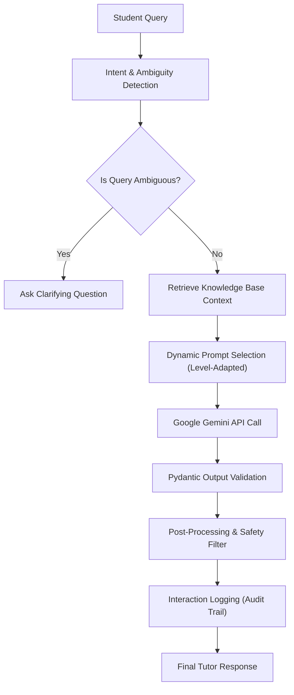

# Experiment 1: Agent-Based Tutoring System

**Domain:** Education / AI Tutoring  
**Platform:** Google Colab / Jupyter Notebook  
**LLM Engine:** Google Gemini (`gemini-pro` / `gemini-1.5-flash`)  
**Validation:** Pydantic schema validation  

---

## 📌 Overview

This experiment demonstrates how to build an **Agent-Based Intelligent Tutoring System** using **Google Gemini**, **Pydantic** for structured output validation, and a domain-specific knowledge base. The tutor agent evaluates student inquiries, classifies intent, retrieves ground truth from its knowledge store, and dynamically tailors its instructional tone and depth across different student mastery levels (beginner, intermediate, advanced).

---

## 🏗️ Architecture & Workflow



---

## 🔑 Key Features & Implementation Modules

1. **Structured Data Validation (`Pydantic`):**
   - `StudentQuery`: Enforces clean, typed input queries.
   - `TutorResponse`: Formats responses with explanation, examples, follow-up challenge questions, and confidence levels.

2. **Domain Knowledge Base:**
   - Pre-loaded with data structures and algorithmic concepts (Stacks, Queues, Linked Lists, Binary Search Trees, Time/Space Complexity).

3. **Intent Classification & Ambiguity Resolution:**
   - Identifies whether a student is requesting a definition, code example, debug help, or concept comparison.
   - Automatically detects vague questions and prompts for clarification.

4. **10 Prompt Optimizations:**
   - **Intent-based Prompt Routing:** Distinct system prompts for theoretical vs. practical code assistance.
   - **Multi-Level Persona Adaptation:** Tuned output complexity for Beginner (analogies), Intermediate (technical depth), and Advanced (edge cases, memory layouts).
   - **Self-Critique & Validation:** Validates generated responses for factual grounding against the internal knowledge base.
   - **Conversational State Tracking:** Keeps track of previous context to support multi-turn dialogue.

5. **Audit Logging & Telemetry:**
   - Logs timestamp, student query, detected intent, student mastery level, response time, and generated answer to an interaction audit log.

---

## 📁 Files in this Directory

- `Experiment1_Tutor_Agent_AAiea_lab_1.ipynb`: Full interactive notebook containing complete source code, tests, and outputs.
- `README.md`: Architectural documentation and execution guide.

---

## 🚀 How to Run

1. Open `Experiment1_Tutor_Agent_AAiea_lab_1.ipynb` in Google Colab or your local Jupyter environment.
2. Install required packages:
   ```bash
   pip install google-generativeai pydantic python-dotenv
   ```
3. Configure your Google Gemini API key:
   ```python
   import os
   os.environ["GEMINI_API_KEY"] = "your-api-key-here"
   ```
4. Execute cells sequentially to run the tutor agent test battery and view the 10 optimization prompt comparisons.
