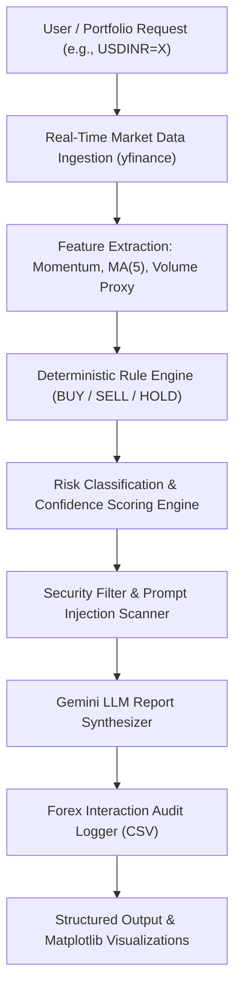

# Experiment 2: Financial Advisory Agent (Forex Trading Advisory Agent)

**Domain:** FinTech / Quantitative Finance & Algorithmic Advisory  
**Platform:** Google Colab / Jupyter Notebook  
**Data Source:** Yahoo Finance (`yfinance`)  
**LLM Engine:** Google Gemini API  
**Security & Guardrails:** Prompt injection resistance, deterministic rule engine, audit logging  

---

## 📌 Overview

This experiment implements an autonomous **Financial & Forex Trading Advisory Agent**. It combines real-time financial market data retrieval (`yfinance`) with a deterministic quantitative rule engine and an LLM synthesis layer. The system calculates price momentum, moving averages, and volatility proxies to derive actionable `BUY`, `SELL`, or `HOLD` recommendations, generates human-readable financial analysis reports, and incorporates strict security boundaries against prompt injection attacks.

---

## 🏗️ Architecture & Pipeline



---

## 🔑 Key Features & Technical Modules

1. **Market Data Pipeline (`yfinance`):**
   - Fetches historical and real-time tick/daily data for currency pairs (e.g., `USDINR=X`, `EURUSD=X`, `GBPUSD=X`).
   - Computes percentage change between recent trading sessions and extracts 5-day moving averages.

2. **Deterministic Decision Engine:**
   - Pre-defined threshold evaluation rules that map percentage changes and technical signals to `BUY`, `SELL`, or `HOLD` actions without relying solely on non-deterministic LLM behavior.
   - `verify_determinism`: Validates reproducibility across repeated runs.

3. **Multi-Indicator & Portfolio Analysis:**
   - `add_moving_average_signal`: Determines whether the asset is trending above or below key moving averages.
   - `volume_proxy_decision`: Incorporates trade activity and volatility proxies.
   - `forex_confidence_score`: Multi-variable confidence score combining trend, momentum, and volatility.
   - `portfolio_forex_analysis`: Batch evaluates multiple currency pairs simultaneously.

4. **Advisory Report Generation via Gemini LLM:**
   - Synthesizes quantitative findings into institutional-grade executive summaries with clear risks and disclaimers.

5. **Security & Robustness Suite:**
   - **Prompt Injection Testing:** Tests adversarial inputs attempting to override trading instructions (e.g., forcing a BUY on a falling asset).
   - **Audit Trail:** Logs every inquiry, timestamp, calculated indicators, recommendation, and security flags to `forex_interaction_log.csv`.

---

## 📁 Files in this Directory

- `AAIEA_LAB_2.ipynb`: Complete Jupyter Notebook containing code, multi-indicator functions, Colab tests, visualization charts, and prompt injection evaluations.
- `README.md`: Architectural documentation and execution guide.

---

## 🚀 How to Run

1. Open `AAIEA_LAB_2.ipynb` in Google Colab or Jupyter Notebook.
2. Install necessary dependencies:
   ```bash
   pip install yfinance pandas requests matplotlib google-genai
   ```
3. Set your Gemini API key in your environment or Google Colab secrets.
4. Run all cells to execute:
   - Currency data fetching and technical rule checks
   - Plotting historical price movements with Matplotlib
   - Generating Gemini financial summaries
   - Running the prompt injection test suite
