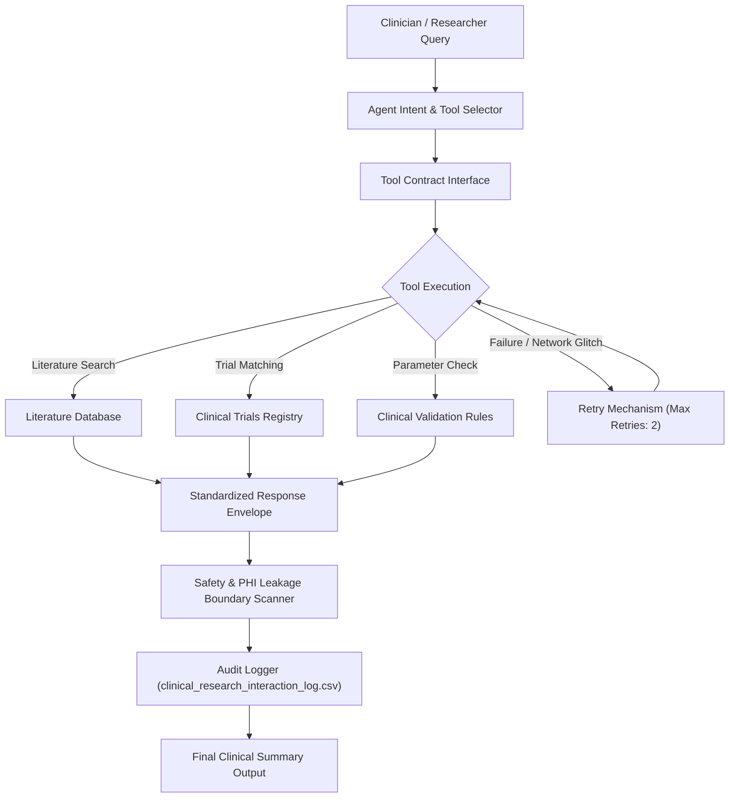

# Experiment 3: Clinical Research Assistant with Tool Integration

**Domain:** Healthcare / Clinical Research & Trial Matching  
**Platform:** Google Colab / Jupyter Notebook  
**Evaluation Scope:** 1,000-sample synthetic benchmark, reliability engineering, safety guardrails  
**Auditing:** `clinical_research_interaction_log.csv`  

---

## 📌 Overview

This experiment develops a robust, tool-augmented **Clinical Research Assistant Agent** designed to assist medical researchers in querying literature, matching patients to clinical trials, and evaluating clinical parameters. The agent utilizes a standardized tool contract interface, connects to controlled healthcare databases, handles real-world tool execution failures via retry policies, and undergoes a comprehensive 1,000-case reliability and security benchmark.

---

## 🏗️ Architecture & Component Design



---

## 🔑 Key Features & Technical Modules

1. **Standardized Tool Contract:**
   - Enforces a predictable schema across all external tools:
     ```json
     {
       "tool_name": "string",
       "parameters": {},
       "status": "SUCCESS | FAILED | RETRIED",
       "result": "...",
       "error": null
     }
     ```

2. **Controlled Healthcare Knowledge Base:**
   - In-memory mock database of peer-reviewed clinical research across chronic diseases (Diabetes, Hypertension, Oncology, Cardiology).
   - Clinical trial inclusion/exclusion criteria database.

3. **Fault Tolerance & Reliability Engineering:**
   - Seeded stochastic simulation (`SEED=42`) modeling realistic production hazards (intermittent API latency, malformed inputs, transient drops).
   - Automatic retry loop with configurable retry depth (`MAX_RETRIES = 2`).

4. **1,000-Interaction Synthetic Benchmark:**
   - Evaluates performance metrics under scale:
     - Tool invocation success rate
     - Mean time to recovery (MTTR)
     - Error classification distribution
     - Schema adherence

5. **Security & Guardrail Evaluation:**
   - Defensive prompt boundary checks.
   - Simulation of adversarial attempts to bypass trial exclusion criteria or leak simulated PHI.
   - Persistent logging to `clinical_research_interaction_log.csv`.

---

## 📁 Files in this Directory

- `AAIEA_LAB_3.ipynb`: Full Jupyter notebook containing complete source code, 1000-sample benchmark tests, and output metrics.
- `README.md`: Architectural documentation and execution guide.

---

## 🚀 How to Run

1. Open `AAIEA_LAB_3.ipynb` in Google Colab or your local Jupyter environment.
2. Install standard dependencies:
   ```bash
   pip install pandas numpy
   ```
3. Run cells to execute the standard tool contract verification, trigger the controlled database queries, and initiate the 1,000-sample synthetic reliability benchmark.
