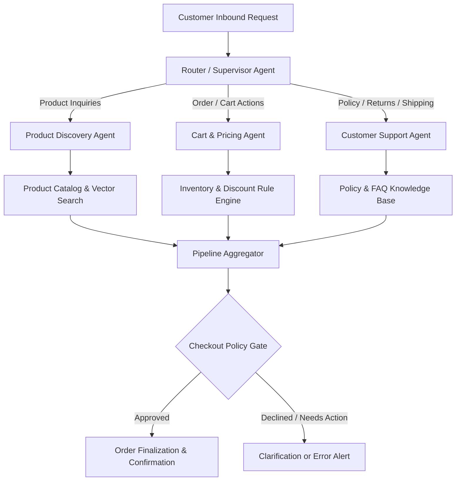

# Experiment 5: E-Commerce Multi-Agent Pipeline

**Domain:** E-Commerce / Multi-Agent Systems & Order Orchestration  
**Platform:** Google Colab / Jupyter Notebook  
**Architecture:** Multi-Agent Pipeline (Discovery, Cart, Support, and Checkout Guardrails)  
**Notebook:** `LAB_5_ecommerce_agent_pipeline.ipynb`  

---

## 📌 Overview

This experiment focuses on an autonomous **E-Commerce Multi-Agent Pipeline**. Modern e-commerce platforms require coordinated interactions across multiple domain agents: answering product questions, maintaining customer shopping carts, validating promotions and discounts, checking inventory, and enforcing checkout security policies. This project outlines and structures the end-to-end multi-agent orchestration workflow.

---

## 🏗️ Multi-Agent Architecture



---

## 🔑 Agent Roles & Tool Specifications

### 1. Supervisor / Router Agent
- Analyzes customer intent from natural language prompts.
- Routes execution tasks to specialized sub-agents or sequences them in a dependency pipeline (e.g., search product -> add to cart -> apply promo code).

### 2. Product Discovery Agent
- Handles semantic product searches, attribute filtering (size, color, brand, price range), and stock checks.
- Generates structured product recommendations.

### 3. Cart & Pricing Agent
- Maintains user session cart state (items, quantities, subtotal).
- Validates discount codes, tax computations, and shipping fee logic.
- Guarantees transactional consistency before checkout.

### 4. Policy & Security Checkout Gate
- Enforces purchasing boundaries (max quantity per customer, address validation, fraud risk flags).
- Prevents price tampering or discount stacking exploits via adversarial user prompts.

---

## 📁 Files in this Directory

- `LAB_5_ecommerce_agent_pipeline.ipynb`: The notebook template for implementing and testing the E-Commerce Multi-Agent Pipeline.
- `README.md`: Architectural specification, agent workflow blueprints, and implementation details.

---

## 🚀 How to Run & Extend

1. Open `LAB_5_ecommerce_agent_pipeline.ipynb` in Google Colab or your local Jupyter environment.
2. Install recommended agent packages:
   ```bash
   pip install pydantic google-generativeai pandas
   ```
3. Follow the modular structure documented above to implement the agent classes, tool definitions, and pipeline execution loops.
